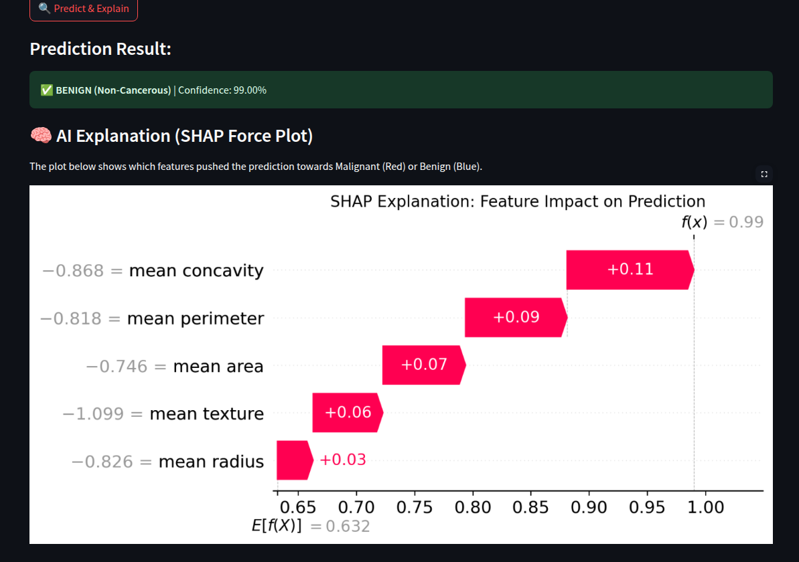
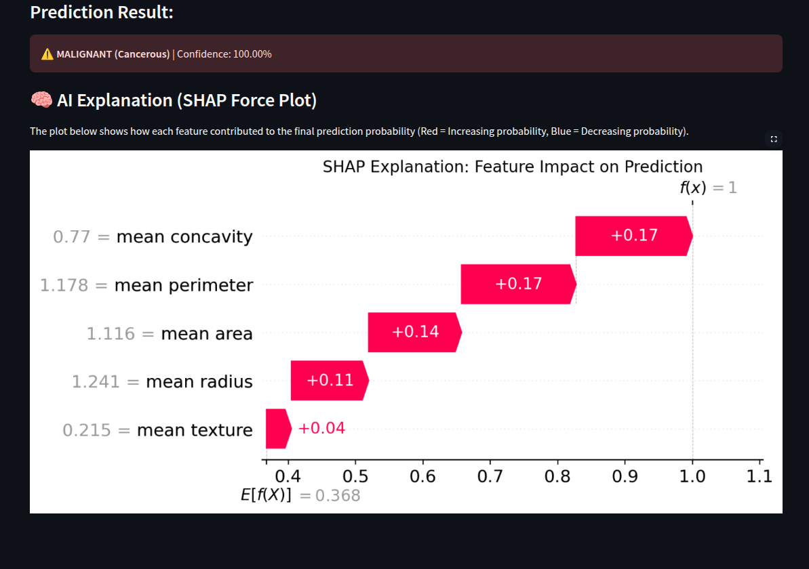

<div align="center">

# 🏥 MediAssist AI

### An Integrated Explainable AI Healthcare Web Application

[](https://python.org)
[](https://streamlit.io)
[](https://scikit-learn.org)
[](https://shap.readthedocs.io)
[](LICENSE)

</div>

---

## 📌 Overview

**MediAssist AI** is a multi-module AI-powered healthcare web application built with Streamlit. It bridges the gap between machine learning predictions and clinical interpretability by combining **Ensemble Learning** with **Explainable AI (XAI)** — making model decisions transparent and trustworthy for healthcare professionals.

The application currently ships with two modules:

| Module | Description |
|--------|-------------|
| 🎗️ **Cancer Predictor (XAI)** | Predicts Breast Cancer risk (Benign / Malignant) from tumor measurements and explains every prediction using SHAP waterfall plots |
| 📝 **Medical NLP Extractor** | Extracts diseases and medications from unstructured medical report text using NLP entity matching |

---

## ✨ Features

- **Real-time Breast Cancer Prediction** — Trained Random Forest classifier on the UCI Breast Cancer Wisconsin dataset with 5 critical tumor features
- **Explainable AI with SHAP** — Every prediction is backed by a SHAP Waterfall plot showing which features drove the decision, and by how much
- **Confidence Scores** — Model outputs class probability alongside the prediction label
- **Medical NLP Entity Extraction** — Identifies diseases and medications from free-form clinical text without any external API
- **Clean, Responsive UI** — Wide layout, sidebar navigation, and two-column input forms for a professional clinical feel
- **Fully Local** — No data leaves your machine; no external APIs or cloud calls

---

## 🖥️ Screenshots

### 🎗️ Cancer Predictor — Benign Prediction (99% Confidence)
> Low feature values → Model confidently predicts Non-Cancerous. SHAP shows all features pushed probability upward from baseline (0.632) to final score (0.99).



---

### 🎗️ Cancer Predictor — Malignant Prediction (100% Confidence)
> High feature values → Model predicts Cancerous with full certainty. SHAP shows mean concavity and mean perimeter as the strongest contributing features.



---

## 🧠 How Explainability Works (SHAP)

SHAP (SHapley Additive exPlanations) assigns each feature an importance value for a specific prediction. The waterfall plot reads as:

- **E[f(X)]** — The model's average prediction across all training samples (baseline)
- **f(x)** — The final prediction for this specific input
- **Red bars (+)** — Features that pushed the prediction *higher* (toward Malignant)
- **Blue bars (−)** — Features that pushed the prediction *lower* (toward Benign)

This gives clinicians a reason behind every output, not just a black-box label.

---

## 🗂️ Project Structure

```
MediAssist_AI/
│
├── app.py                  # Main Streamlit application (all modules)
├── requirements.txt        # Pinned Python dependencies
├── .gitignore              # Excludes venv, cache, secrets, model binaries
│
└── screenshots/
    ├── cancer_predictor_benign_shap.png    # BENIGN prediction — 99% confidence
    └── cancer_predictor_malignant_shap.png # MALIGNANT prediction — 100% confidence
```

---

## ⚙️ Tech Stack

| Layer | Technology |
|-------|-----------|
| UI Framework | Streamlit 1.41.1 |
| ML Model | Random Forest Classifier (scikit-learn 1.6.1) |
| XAI / Explainability | SHAP 0.47.1 |
| Data Processing | Pandas 2.2.3, NumPy 1.26.4 |
| Visualization | Matplotlib 3.10.0 |
| Dataset | UCI Breast Cancer Wisconsin (via sklearn.datasets) |

---

## 🚀 Getting Started

### Prerequisites
- Python 3.10+

### Installation

```bash
# 1. Clone the repository
git clone https://github.com/YashKasare21/MediAssist_AI.git
cd MediAssist_AI

# 2. Create and activate a virtual environment
python3 -m venv venv
source venv/bin/activate        # On Windows: venv\Scripts\activate

# 3. Install dependencies
pip install -r requirements.txt

# 4. Run the app
streamlit run app.py
```

The app will open automatically at `http://localhost:8501`

---

## 📊 Model Details

### Breast Cancer Predictor

- **Dataset:** UCI Breast Cancer Wisconsin (569 samples, 30 features)
- **Features Used:** 5 most clinically significant tumor measurements
  - Mean Radius
  - Mean Texture
  - Mean Perimeter
  - Mean Area
  - Mean Concavity
- **Algorithm:** Random Forest (100 estimators, random_state=42)
- **Preprocessing:** StandardScaler for feature normalization
- **Train/Test Split:** 80% / 20%

### Medical NLP Extractor

- **Approach:** Dictionary-based entity matching (no external NLP library required)
- **Entities Detected:** Diseases (cancer, diabetes, hypertension, asthma, etc.) and Medications (aspirin, metformin, insulin, etc.)
- **Input:** Free-form clinical report text

---

## 🔮 Roadmap

- [ ] Add more cancer types (lung, skin) with dedicated models
- [ ] Integrate spaCy / scispaCy for production-grade medical NLP
- [ ] Add LIME explanations as an alternative to SHAP
- [ ] Export predictions and SHAP plots as PDF reports
- [ ] Deploy to Streamlit Cloud

---

## 🤝 Contributing

Contributions are welcome! Feel free to open an issue or submit a pull request.

1. Fork the repository
2. Create a feature branch: `git checkout -b feature/your-feature`
3. Commit your changes: `git commit -m 'feat: add your feature'`
4. Push and open a PR: `git push origin feature/your-feature`

---

## 📄 License

This project is licensed under the **MIT License** — see the [LICENSE](LICENSE) file for details.

---

<div align="center">
Made with ❤️ by <a href="https://github.com/YashKasare21">Yash Kasare</a>
</div>
